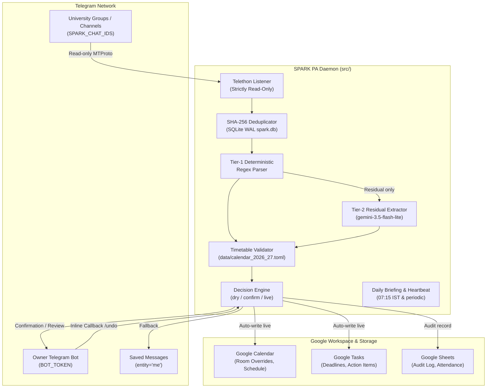
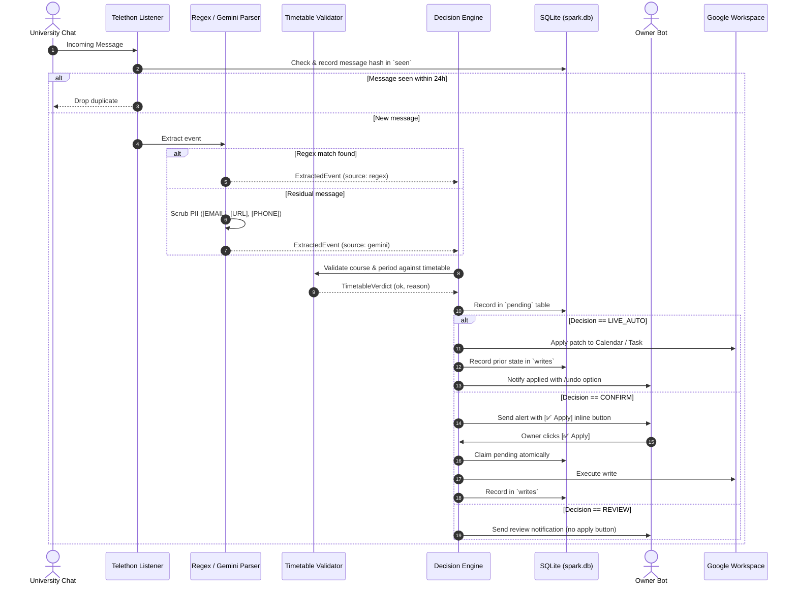
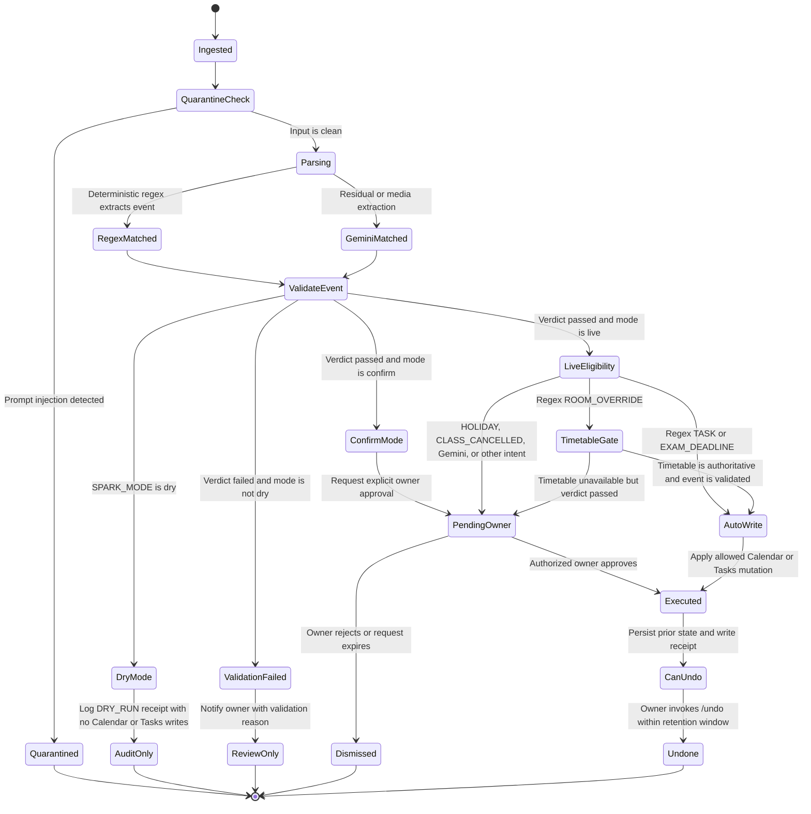

# ChatLens & SPARK PA Assistant

<p align="center">
  
</p>

[](adr/0001-awesome-dev-pipeline-adoption.md)
[](https://www.python.org/downloads/release/python-3120/)
[](https://nextjs.org/)
[](https://fastapi.tiangolo.com/)
[-orange.svg)]()

Headless Telegram-to-Google Workspace personal assistant and chat analysis platform for a KLEF student (`Asia/Kolkata`, IST).

---

## 1. System Architecture

The repository contains two operational stacks:
1. **SPARK PA Daemon (`src/`)**: Autonomous headless assistant watching university Telegram groups, parsing notices, validating timetable constraints, and synchronizing with Google Calendar, Tasks, and Sheets.
2. **ChatLens Platform (`chatlens-v2/`)**: Full-stack multi-channel chat analysis application with a Next.js 16 App Router frontend, a FastAPI/SQLAlchemy (`pgvector`) backend, and asynchronous Celery workers.



---

## 2. Ingestion & Decision Lifecycle



---

## 3. SPARK_MODE State Machine

The daemon's runtime decision is made by `src.ingestion.handlers.decide()`. The order of
evaluation matters: **`dry` always audits without Calendar/Tasks writes; in `confirm` and
`live`, a failed validation goes to review before any write decision.** A valid event in
`live` is auto-applied only when it matches the narrow allowlist below.



### 3.1 Decision matrix

| Event / condition | `dry` | `confirm` | `live` |
|---|---|---|---|
| Read-only command | Allow read | Allow read | Allow read |
| Any extracted event; no external mutation | Audit-only `DRY_RUN` | Continue to validation | Continue to validation |
| Validation fails | Audit-only `DRY_RUN` | Review alert; no apply action | Review alert; no apply action |
| `ROOM_OVERRIDE`, regex, validation passes, authoritative timetable ready | Audit-only `DRY_RUN` | Owner approval required | **Auto-write** |
| `ROOM_OVERRIDE`, regex, verdict passes but timetable is unavailable/sample | Audit-only `DRY_RUN` | Owner approval required | Owner approval required |
| `TASK` / `EXAM_DEADLINE`, regex, validation passes | Audit-only `DRY_RUN` | Owner approval required | **Auto-write** |
| Gemini-derived event, validation passes | Audit-only `DRY_RUN` | Owner approval required | Owner approval required |
| `HOLIDAY` / `CLASS_CANCELLED`, validation passes | Audit-only `DRY_RUN` | Owner approval required | Owner approval required |
| Other mutation / unsupported intent | Audit-only `DRY_RUN` | Owner approval or conservative review | Owner approval or conservative review |
| Prompt-injection quarantine | Block and alert | Block and alert | Block and alert |

**Safety invariants:** Telegram group/channel ingestion is read-only; only the owner bot or Saved
Messages may receive output. No Calendar/Tasks mutation occurs in `dry`. Validation failures in
`confirm`/`live` never expose an apply action. In `live`, only regex-derived, validated room
overrides with an authoritative timetable and regex-derived tasks/deadlines can auto-write.
Holiday/cancellation and Gemini-derived events require explicit owner approval.
---

## 4. Domain Constants & Invariants

### 4.1 Canonical Courses & Aliases
| Key | Course Name | Official Code | Recognized Aliases |
|---|---|---|---|
| `DSA` | Data Structures & Algorithms-3 | `25CS2103E` | `DSA`, `DATA STRUCTURES`, `DSA3`, `DSA-3` |
| `OSSP` | Operating Systems & Systems Programming | `25CS2104E` | `OSSP`, `OPERATING SYSTEMS` |
| `ML` | Machine Learning | `25SC2107E` | `ML`, `MLNG`, `MACHINE LEARNING` |
| `ESD` | Embedded System Design & IoT | `25EC2206E` | `ESD`, `EBSD`, `IOT`, `EMBEDDED SYSTEM` |
| `DBSE` | Database Systems Engineering | `25CS1302E` | `DBSE`, `DATABASE SYSTEMS` |
| `JAPANESE` | Japanese Language Proficiency-2 | `25FL2112E` | `JAPANESE`, `JPN`, `FLP-2` |

### 4.2 Standard Academic Periods (IST)
> [!NOTE]
> All periods are strictly Indian Standard Time (`Asia/Kolkata`, UTC+05:30). **There is no P6 period.**

| Period | Start Time | End Time |
|---|---|---|
| **P1** | 08:10 | 09:00 |
| **P2** | 09:00 | 09:50 |
| **P3** | 10:00 | 10:50 |
| **P4** | 10:50 | 11:40 |
| **P5** | 11:50 | 12:40 |
| **P7** | 13:20 | 14:10 |
| **P8** | 14:20 | 15:10 |
| **P9** | 15:10 | 16:00 |

### 4.3 SPARK_MODE Decision Matrix
| Extracted Intent | Extraction Source | Timetable Verdict | `dry` | `confirm` | `live` |
|---|---|---|---|---|---|
| `ROOM_OVERRIDE` | Regex | OK | No write (audit) | Owner ✅ required | **Auto-write** |
| `ROOM_OVERRIDE` | Regex | Failed | Review alert | Review alert | Review alert |
| `ROOM_OVERRIDE` | Gemini | Any | No write (audit) | Owner ✅ required | Owner ✅ required |
| `TASK` / `EXAM_DEADLINE` | Regex | N/A | No write (audit) | Owner ✅ required | **Auto-write** |
| `TASK` / `EXAM_DEADLINE` | Gemini | N/A | No write (audit) | Owner ✅ required | Owner ✅ required |
| `HOLIDAY` | Regex / Gemini | N/A | No write (audit) | Owner ✅ required | Owner ✅ required |
| `CLASS_CANCELLED` | Regex / Gemini | Any | No write (audit) | Owner ✅ required | Owner ✅ required |

---

## 5. Configuration & Environment Variables

Create a `.env` file in the repository root based on `.env.example`:

| Environment Variable | Type | Default | Description |
|---|---|---|---|
| `TELEGRAM_API_ID` | `int` | *Required* | Telegram API application ID |
| `TELEGRAM_API_HASH` | `SecretStr` | *Required* | Telegram API application hash |
| `TELEGRAM_SESSION_STRING` | `SecretStr` | `""` | Telethon StringSession credentials |
| `BOT_TOKEN` | `SecretStr` | `""` | Telegram Bot API token for private owner interaction |
| `OWNER_CHAT_ID` | `int` | `0` | Owner's private Telegram chat ID |
| `GOOGLE_CREDENTIALS_BASE64` | `SecretStr` | `""` | Base64-encoded Google service account JSON |
| `GOOGLE_CALENDAR_ID` | `str` | `"primary"` | Google Calendar ID for events |
| `GOOGLE_SHEET_ID` | `str` | `""` | Google Sheet ID for audit logs and attendance |
| `GEMINI_API_KEY` | `SecretStr` | `""` | Google Gemini API key |
| `GEMINI_MODEL` | `str` | `"gemini-3.5-flash-lite"` | Active Gemini model |
| `GEMINI_DAILY_BUDGET` | `int` | `50` | Maximum Gemini API calls permitted per day |
| `SPARK_MODE` | `str` | `"dry"` | Operating mode: `dry`, `confirm`, or `live` |
| `SPARK_CHAT_IDS` | `str` | *Required* | Comma-separated list of allowed chat/channel IDs |
| `SPARK_DB` | `Path` | `"spark.db"` | SQLite database file path (WAL mode) |
| `SPARK_MEDIA` | `bool` | `False` | Enable multimodal Gemini processing (voice/photos) |
| `SPARK_TIMETABLE` | `Path` | `None` | Path to canonical timetable TOML file |
| `LOG_LEVEL` | `str` | `"INFO"` | Logging verbosity (`DEBUG`, `INFO`, `WARNING`, `ERROR`) |
| `SENTRY_DSN` | `str` | `None` | Sentry DSN for exception tracking |

---

## 6. Setup & Development

### 6.1 Prerequisites
- Python 3.12 or newer
- `uv` (Astral Python package manager)
- Node.js 20+ and `npm`
- Docker & Docker Compose (optional for full platform orchestration)

### 6.2 Local Installation
```bash
# Clone the repository
git clone https://github.com/tejaswin-amara/chatlens.git
cd chatlens

# Install Python virtual environment and dependencies
uv sync --all-extras --dev

# Install Frontend dependencies
cd chatlens-v2/frontend && npm ci && cd ../..
```

### 6.3 Helper Setup Scripts
```bash
# Generate Telethon session string
uv run python scripts/generate_session.py

# List accessible Telegram chats to find IDs for SPARK_CHAT_IDS
uv run python scripts/list_chats.py

# Encode Google Service Account credentials to base64
uv run python scripts/google_token.py
```

### 6.4 Running the SPARK PA Daemon
```bash
uv run python -m src.main
```

### 6.5 Running Full Stack via Docker Compose
```bash
docker compose up -d
```
Services exposed:
- `chatlens-daemon`: Headless assistant background container
- `chatlens-backend`: FastAPI REST API bound to `http://127.0.0.1:8000` (protected in production)
- `chatlens-frontend`: internal static web UI; use the Caddy URL at `https://localhost`
- `postgres`: PostgreSQL + `pgvector` on `localhost:5432`
- `redis`: Redis task broker on `localhost:6379`
- `chatlens-celery`: Asynchronous task execution worker

---

## 7. Production Access Control

The ChatLens backend handles private conversation archives and must not be exposed without authentication. In production, every API route except `GET /api/healthz` requires a Firebase ID token and an email address listed in `CHATLENS_ALLOWED_EMAILS`. All allowlisted users can access the same configured chat database.

1. In the Firebase Console, enable Google as a sign-in provider and register a web app.
2. Fill all six `NEXT_PUBLIC_FIREBASE_*` variables in `.env` using that web app's configuration.
3. Create a Firebase Admin service-account JSON for the same Firebase project. Store it at the path configured by `FIREBASE_ADMIN_CREDENTIALS_FILE` (default: `./secrets/firebase-admin.json`). The file is mounted read-only into the backend and must never be committed.
4. Set `CHATLENS_ALLOWED_EMAILS` to a comma-separated list of permitted email addresses.
5. Rebuild and start the stack with `docker compose up -d --build`.

The `GET /api/auth/me` endpoint checks a signed-in user's session and allowlist access. The `/api/healthz` route is the only unauthenticated production API endpoint. The API fails closed when authentication is required but credentials, an ID token, or the email allowlist are invalid or missing. Keep service-account credentials out of source control and only allow trusted email addresses.

## 8. Verification & Quality Gates

Run the complete local verification suite:

```bash
# 1. Lint Python codebase
uv run ruff check src tests scripts chatlens-v2/backend

# 2. Check Python formatting
uv run ruff format --check src tests scripts chatlens-v2/backend

# 3. Static type checking
uv run mypy src scripts benchmarks chatlens-v2/backend

# 4. Run test suite with strict runtime warning elevation
uv run pytest -q -W error::RuntimeWarning

# 5. Verify prompt drift between code and evaluation fixtures
uv run pytest -q tests/test_prompt_drift.py

# 6. Run frontend checks
cd chatlens-v2/frontend && npm run lint && npx tsc --noEmit && npm run build && cd ../..

# 7. Secret scanning
gitleaks git --redact --no-banner
```

---

## 9. License & Governance
* Built under **Awesome Dev Pipeline v2.2.0**.
* Architectural decisions documented in [`adr/`](adr/).
* Threat model documented in [`adr/threat-model.md`](adr/threat-model.md).
