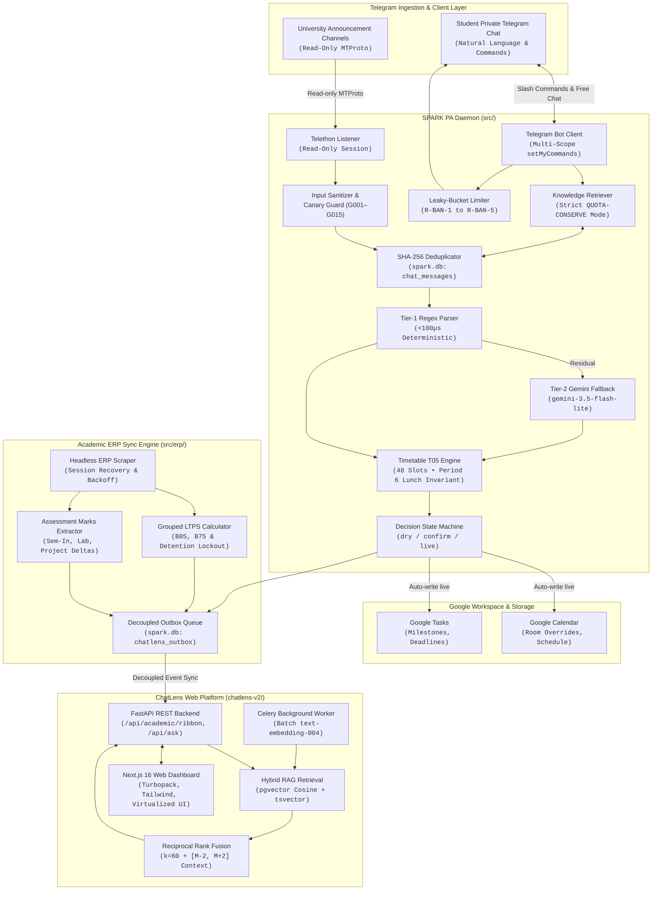
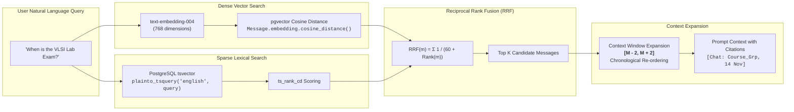

<div align="center">

# ⚡ ChatLens & SPARK PA
### Autonomous Academic Personal Assistant & Multi-Channel Chat Intelligence Platform

[](https://www.python.org/)
[](https://fastapi.tiangolo.com/)
[](https://nextjs.org/)
[](https://github.com/pgvector/pgvector)
[](https://docs.celeryq.dev/)
[](https://redis.io/)
[](adr/0001-awesome-dev-pipeline-adoption.md)
[]()
[]()
[](LICENSE)

<p align="center">
  
</p>

**ChatLens & SPARK PA** is an enterprise-grade, full-duplex personal academic intelligence suite designed for university engineering students under the Project-Based Learning (PBL) model. It combines a 24/7 autonomous Telegram ingestion daemon with real-time timetable validation, hierarchical LTPS attendance calculations, internal marks tracking, Google Workspace synchronization, and a modern web dashboard with hybrid vector search.

[⚡ Architecture](#-system-architecture) • [✨ Key Features](#-key-features--visual-showcase) • [📊 LTPS Attendance](#-hierarchical-ltps-attendance-engine) • [🔍 Hybrid RAG](#-hybrid-rag-semantic-retrieval-engine) • [🤖 Telegram Bot](#-telegram-pa-bot-interface) • [🚀 Quickstart](#-quickstart--local-development) • [🛡️ Compliance](#%EF%B8%8F-anti-ban--platform-compliance) • [🧪 Quality Gates](#-verification--quality-gates)

</div>

---

## ⚡ System Architecture

The repository orchestrates two decoupled, high-performance operational components bridged via an asynchronous SQLite Outbox pattern:

1. **SPARK PA Daemon (`src/`)**: A headless, read-only MTProto listener that ingests university course channels, sanitizes prompt injections, deterministically parses notices via sub-millisecond regexes, validates timetable constraints, and manages two-way synchronization with Google Calendar, Google Tasks, and Telegram.
2. **ChatLens Platform (`chatlens-v2/`)**: A full-stack web application featuring a Next.js 16 (App Router + Turbopack) frontend, a FastAPI backend with PostgreSQL `pgvector`, and Celery workers performing batch `text-embedding-004` generation.



---

## ✨ Key Features & Visual Showcase

### 📊 Hierarchical LTPS Attendance Engine
University engineering curricula feature composite Lecture (L), Tutorial (T), Practical (P), and Skilling (S) components. SPARK computes exact hours conducted ($C$) and attended ($A$), component-level and composite percentages, safe bunk margins ($B_{85}, B_{75}$), and remaining term classes ($R$) to flag hard detention lockouts before they happen:

```text
📊 Live Academic Attendance & Safe Bunk Margins
🕒 Term T05 • Updated: 14 Nov 2026, 20:15 IST

• 🧠 GENAI (24CS2105A) — 90.48% 🟢 Safe
  ├ 📘 Lecture: 88.89% (16/18 hrs) [████████░░] 🟢 +0 safe
  └ 💻 Practical: 91.67% (22/24 hrs) [█████████░] 🟢 +2 safe

• 🌐 CNNP (24CS2104A) — 80.00% 🟡 Borderline
  ├ 📘 Lecture: 83.33% (20/24 hrs) [████████░░] 🟡 +0 safe (need 2 for 85%)
  └ 💻 Practical: 75.00% (12/16 hrs) [███████░░░] 🔴 0 safe (need 3 for 85%)

• ⚙️ DLAC (24CS2103A) — 66.67% 🚨 DETENTION LOCKOUT
  ├ 📘 Lecture: 68.75% (11/16 hrs) [██████░░░░] 🔴 (need 8 for 75%)
  └ 🛠️ Skilling: 62.50% (5/8 hrs) [██████░░░░] 🔴 (need 5 for 75%)
  ⚠️ 13 classes needed to reach 75%, but only 8 classes remain before 28 Jan!

💡 Tip: Tap /bunk <course> to simulate upcoming attendance impacts.
```

---

### 🧮 Predictive Bunk Simulator (`/bunk`)
The `/bunk` interactive command allows students to test future attendance hypothetical scenarios:

```text
🧮 Predictive Attendance Simulator: GENAI (24CS2105A)
Current Status: 38/42 hrs (90.48%) • 18 Term Classes Remaining

┌───────────────────────────────────────┬────────────┬─────────────┐
│ Scenario                              │ Projected  │ Margin      │
├───────────────────────────────────────┼────────────┼─────────────┤
│ Skip next 1 class (38/43)             │ 88.37%     │ 🟢 +1 Safe  │
│ Skip next 2 classes (38/44)           │ 86.36%     │ 🟢 +0 Safe  │
│ Skip next 3 classes (38/45)           │ 84.44%     │ 🟡 Borderline│
│ Skip next 5 classes (38/47)           │ 80.85%     │ 🔴 -2 Bunk  │
└───────────────────────────────────────┴────────────┴─────────────┘
🎯 Buffer: You can safely bunk 2 more classes while maintaining ≥ 85.0%.
```

---

### 🔍 Hybrid RAG Semantic Retrieval Engine
ChatLens fuses dense vector embeddings with PostgreSQL lexical ranking via Reciprocal Rank Fusion ($RRF$, $k=60$) and expands surrounding context $[M-2, M+2]$ to provide complete conversational context without hallucinations:



---

### 🤖 Telegram PA Bot Interface
SPARK registers all **21 commands** across Telegram API scopes (`default`, `all_private_chats`, `chat`):

| Command | Description | Action |
| :--- | :--- | :--- |
| `/start` | Open SPARK PA Academic Assistant | Interactive Welcome & Consent Portal |
| `/today` | Today's classes, rooms & status | 4-slot day schedule with real-time indicators |
| `/tomorrow` | Tomorrow's schedule & upcoming classes | Day schedule with faculty & section metadata |
| `/timetable` | Official weekly timetable & rooms | Weekly grid for Trimester-5 (T05) |
| `/courses` | Registered courses, credits & faculty | Course catalog with LTPS credit schemes |
| `/attendance`| Live attendance & grouped LTPS breakdown | Hierarchical cards with safe bunk buffers |
| `/bunk` | Exact safe bunks & recovery calculator | Predictive bunk scenario simulator |
| `/deadlines` | Upcoming task deadlines & milestones | Overdue, today, and future milestone cards |
| `/briefing` | Generate today's academic briefing | 07:15 IST morning intelligence digest |
| `/marks` | In-sem internal marks & assessments | Sem-In 1, Sem-In 2, Lab & Project scores |
| `/cgpa` | Official academic grades & transcript | Cumulative GPA and semester credit tally |
| `/exam` | In-sem lab exams & viva schedules | Exam schedules, venues, and timings |
| `/ask` | Instant AI answers (viva prep, questions)| Semantically grounded RAG answers |
| `/fee` | Fee orders & payment receipts | ERP fee status, receipts, and deadlines |
| `/sync` | On-demand ERP crawl & delta sync | Immediate background portal synchronization |
| `/status` | Live daemon & chat monitoring status | Healthcheck, uptime, memory, and chat stats |
| `/rescan` | Deep-scan course groups (past 7 days) | Catch-up rescan of allowlisted channels |
| `/quarantine`| View isolated prompt injection attempts | Audit log of suppressed malicious notices |
| `/undo` | Revert last applied calendar override | Atomic undo of Google Calendar/Tasks mutations |
| `/index_summary` | Executive briefing across chats & documents | Comprehensive discovery briefing |
| `/help` | Show all available options | Interactive command catalog |

---

## 🚀 Quickstart & Local Development

### 1. Docker Compose (Full Stack Orchestration)
Run the entire production platform (Nginx, Caddy, Next.js, FastAPI, PostgreSQL + pgvector, Redis, Celery, and SPARK Daemon) in one command:

```bash
# Clone the repository
git clone https://github.com/tejaswin-amara/chatlens.git
cd chatlens

# Configure environment variables
cp .env.production.example .env

# Launch all 8 container services
docker compose up -d --build
```

Access the web dashboard at `https://localhost` (or your configured `DOMAIN`).

---

### 2. Local Python & Frontend Development

#### Prerequisites
- **Python**: 3.12 or newer
- **uv**: Astral Python package manager (`pip install uv` or `curl -LsSf https://astral.sh/uv/install.sh | sh`)
- **Node.js**: 20+ and `npm`

#### Setup
```bash
# 1. Sync Python virtual environment and dependencies
uv sync --all-extras --dev

# 2. Setup environment file
cp .env.example .env
# Edit .env with your Telegram API, Bot Token, and Google credentials

# 3. Install Next.js frontend dependencies
cd chatlens-v2/frontend && npm ci && cd ../..

# 4. Start the SPARK PA Daemon in background with healthcheck
powershell -ExecutionPolicy Bypass -File scripts/run_daemon.ps1 -Background
powershell -ExecutionPolicy Bypass -File scripts/run_daemon.ps1 -HealthCheck

# 5. Start Next.js Development Server
cd chatlens-v2/frontend && npm run dev
```

---

## 🛡️ Anti-Ban & Platform Compliance

SPARK operates on personal MTProto user sessions, strictly enforcing five non-negotiable anti-ban invariants:

- **[R-BAN-1] Multi-Tier Leaky Bucket Rate Limiter**: 1 req/sec for direct messages, 20 req/min for group channels, and 25 req/sec globally, backed by persistent SQLite FloodWait backoff.
- **[R-BAN-2] Strictly Read-Only Group Ingestion**: The daemon **never** sends messages, forwards, or reacts inside university groups or channels. All outbound notifications route solely to the owner's private chat or Saved Messages (`"me"`).
- **[R-BAN-3] 15-Minute Startup Debounce**: Persistent cooldown in SQLite `meta` (`daemon_startup_debounce`) suppresses notification flooding during crash loops or supervisor restarts.
- **[R-BAN-4] Strict Chat Allowlist Boundary**: Only chats explicitly enumerated in `SPARK_CHAT_IDS` are ingested. If empty, the daemon refuses to start (exit code 2).
- **[R-BAN-5] Circuit Breaker & Safe Degradation**: Consecutive API errors trigger exponential backoff, failing closed to prevent credential or account invalidation.

---

## 🧪 Verification & Quality Gates

The codebase strictly complies with the **Awesome Dev Pipeline v2.2.0** offline verification standard:

```bash
# Run full automated check suite
make check

# Or execute individual verification gates:
# 1. Python Linting & Formatting
uv run ruff check src tests scripts chatlens-v2/backend
uv run ruff format --check src tests scripts chatlens-v2/backend

# 2. Strict Type Checking
uv run mypy src scripts benchmarks chatlens-v2/backend

# 3. Fast Parallel Test Suite
uv run pytest -q -n auto tests/

# 4. Frontend Unit Tests & Production Build
cd chatlens-v2/frontend
npm test -- --run
npm run lint
npx tsc --noEmit
npm run build
```

---

## 📄 License & Governance
- Licensed under the **MIT License**. See [`LICENSE`](LICENSE) for complete details.
- Governed by **Awesome Dev Pipeline v2.2.0**.
- Architectural Decision Records maintained in [`adr/`](adr/) and [`docs/ARCHITECTURE_T05.md`](docs/ARCHITECTURE_T05.md).
