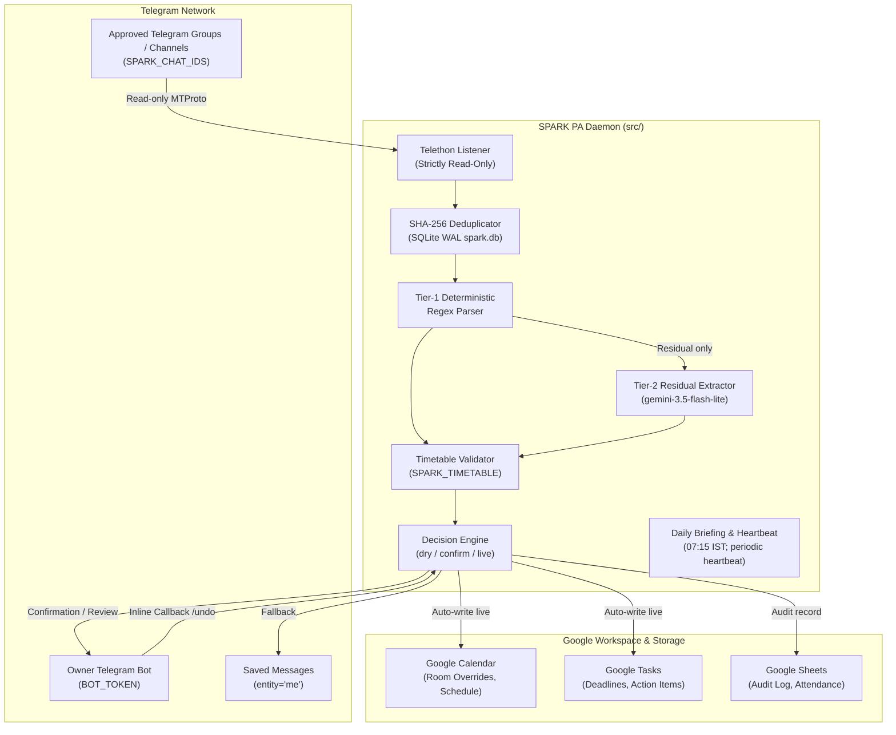
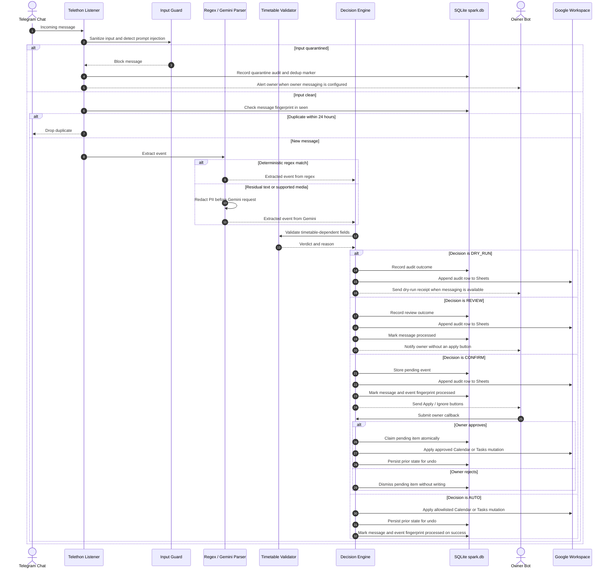
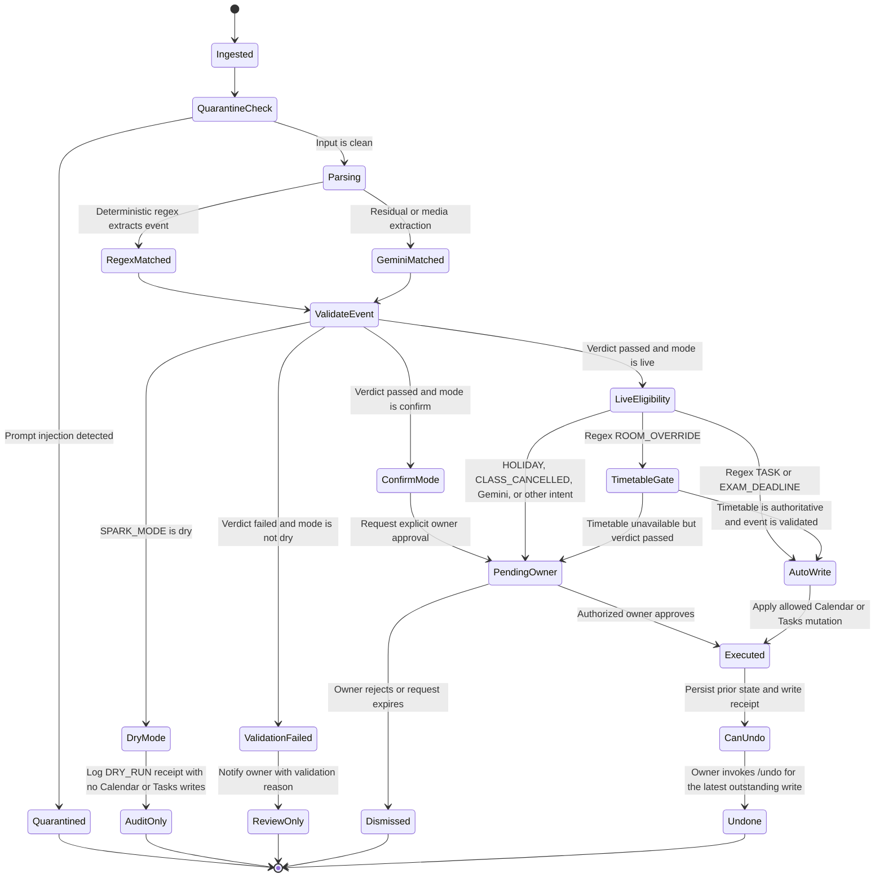

# ChatLens & SPARK PA Assistant

<p align="center">
  
</p>

[](adr/0001-awesome-dev-pipeline-adoption.md)
[](https://www.python.org/downloads/release/python-3120/)
[](https://nextjs.org/)
[](https://fastapi.tiangolo.com/)

ChatLens contains two related components: SPARK, a headless Telegram-to-Google Workspace assistant, and a web platform for importing and analyzing Telegram and WhatsApp chat exports. The SPARK settings and academic data in this repository reflect one current deployment; review Section 4 before reusing the daemon elsewhere.

---

## 1. System Architecture

The repository contains two operational stacks:
1. **SPARK PA Daemon (`src/`)**: Autonomous headless assistant watching university Telegram groups, parsing notices, validating timetable constraints, and synchronizing with Google Calendar, Tasks, and Sheets.
2. **ChatLens Platform (`chatlens-v2/`)**: Full-stack multi-channel chat analysis application with a Next.js 16 App Router frontend, a FastAPI/SQLAlchemy (`pgvector`) backend, and asynchronous Celery workers.



---

## 2. Ingestion & Decision Lifecycle



---

## 3. SPARK_MODE State Machine

The daemon's runtime decision is made by `src.ingestion.handlers.decide()`. The order of
evaluation matters: **`dry` records an audit outcome but never mutates Calendar or Tasks; in
`confirm` and `live`, a failed validation goes to review before any write decision.** A valid
event in `live` is auto-applied only when it matches the narrow allowlist below. Audit records
may still be written to SQLite and Google Sheets while `SPARK_MODE=dry`.



### 3.1 Decision matrix

| Event / condition | `dry` | `confirm` | `live` |
|---|---|---|---|
| Read-only bot command | Available | Available | Available |
| `ROOM_OVERRIDE` from regex; validation passes and authoritative timetable is ready | Audit only; no Calendar/Tasks mutation | Owner approval required | **Auto-write** |
| `ROOM_OVERRIDE` from regex; timetable is missing or marked as sample | Audit only; no Calendar/Tasks mutation | Owner approval required | Owner approval required |
| `TASK` / `EXAM_DEADLINE` from regex | Audit only; no Calendar/Tasks mutation | Owner approval required | **Auto-write** |
| Gemini-derived event | Audit only; no Calendar/Tasks mutation | Owner approval required | Owner approval required |
| `HOLIDAY` / `CLASS_CANCELLED` | Audit only; no Calendar/Tasks mutation | Owner approval required | Owner approval required |
| Timetable-dependent event fails validation | Audit outcome; no Calendar/Tasks mutation | Review notification; no apply button | Review notification; no apply button |
| Other mutation or unsupported intent | Audit only; no Calendar/Tasks mutation | Owner approval or conservative review | Owner approval or conservative review |
| Input is quarantined by the security guard | Block; alert owner when messaging is configured | Block; alert owner when messaging is configured | Block; alert owner when messaging is configured |

**Safety invariants:** Telegram group/channel ingestion is read-only. `dry` can write audit records to SQLite or Sheets but never mutates Calendar or Tasks. Validation failures in `confirm` and `live` never expose an apply action. In `live`, only regex-derived room overrides with an authoritative timetable and regex-derived tasks/deadlines can auto-write. Gemini-derived events, holidays, and class cancellations require explicit owner approval when writes are enabled.
---

## 4. Deployment-Specific Data & Safe Customization

Academic data is **not universal**. Course identifiers, aliases, section names, room formats, class
periods, term dates, ERP account settings, and time zones vary by institution and academic year. The
values currently in this repository reflect one deployment and must not be treated as portable defaults.

Before using the SPARK daemon for another institution or term, review the current implementation
and update the relevant sources together:

| Concern | Current source of truth | What to verify |
|---|---|---|
| Course names, official codes, and text aliases | `src/parsing/regex_parser.py`, `src/timetable/__init__.py` | Supported courses, official IDs, aliases, and canonical names |
| Period numbers, period times, room formats, and section assumptions | `src/timetable/__init__.py`, `src/parsing/regex_parser.py` | Actual timetable periods, breaks, rooms, sections, and parsing patterns |
| Active term schedule | TOML file selected by `SPARK_TIMETABLE` (current default: `data/timetable_T04.toml`) | Term, validity dates, course slots, rooms, and faculty |
| Time zone and date interpretation | `src/utils/clock.py` | The institution's time zone and consistent handling of incoming timestamps |
| Official academic milestones | `src/academic_calendar.py` and `data/calendar_2026_27.toml` | Exam dates, fee deadlines, last instruction day, and other protected dates |
| Runtime and container timezone | `src/utils/clock.py` and `Dockerfile` | IST is currently hard-coded; update both the Python clock and container settings before using another timezone |
| ERP account settings | `src/config.py` (`ERP_USERNAME`, `ERP_PASSWORD`) | Configure the target account explicitly; do not reuse the current deployment-specific username fallback |

Some values are currently **defined in code**, not controlled by `.env` alone. Changing
`SPARK_TIMETABLE` does not automatically update the regex course aliases, period-time mappings,
room/section assumptions, time zone, or academic-milestone rules. Verify these dependencies before
claiming another deployment is supported.

### Customization checklist

1. Use an authoritative timetable and academic calendar for the target institution and term.
2. Update the corresponding code/data sources; keep identifiers, parsing rules, time windows, and
   validation logic consistent.
3. Update or add regression tests for course detection, date interpretation, period mapping,
   timetable validation, and milestone-conflict handling.
4. Run the verification suite in Section 8. Keep `SPARK_MODE=dry` until the target deployment's
   valid, invalid, ambiguous, and approval-required cases have been tested.

The safety policy is intended to remain consistent across deployments: community messages are
untrusted input, timetable/calendar mismatches must not be silently applied, and live automatic
writes must stay limited to the explicitly approved policy cases. These rules do not make the
current course parser, timetable, ERP integration, or timezone portable without customization.
## 5. Configuration & Environment Variables

For local SPARK development, start with [`.env.example`](.env.example). The table below documents the daemon settings in `src/config.py`; defaults are code defaults unless noted otherwise.

| Variable | Code default | Notes |
|---|---|---|
| `TELEGRAM_API_ID` | `0` | Required at startup; obtain from Telegram's developer portal |
| `TELEGRAM_API_HASH` | Empty | Required at startup; treat as a credential |
| `TELEGRAM_SESSION_STRING` | Empty | Required at startup; contains session credentials |
| `GOOGLE_CREDENTIALS_BASE64` | Empty | Required at startup; base64-encoded Google credentials |
| `GOOGLE_CALENDAR_ID` | `primary` | Target Google Calendar |
| `GOOGLE_SHEET_ID` | Unset | Spreadsheet used by Sheets logging and attendance features |
| `GEMINI_API_KEY` | Empty | Required at startup |
| `GEMINI_MODEL` | `gemini-3.5-flash-lite` | Model used for residual extraction; verify any replacement model before deployment |
| `GEMINI_DAILY_BUDGET` | `50` | Daily budget for Gemini requests |
| `SPARK_MODE` | `dry` for direct execution; `confirm` if unset in Compose | `dry`, `confirm`, or `live`; see Section 3 before enabling writes |
| `SPARK_CHAT_IDS` | Empty | Required at startup; comma-separated allowlist of permitted chat/channel IDs |
| `SPARK_DB` | `spark.db` | SQLite database path; Compose sets `/app/data/spark.db` on its persistent volume |
| `SPARK_MEDIA` | `false` | Media extraction is disabled unless explicitly enabled |
| `SPARK_TIMETABLE` | `data/timetable_T04.toml` | Active timetable file; see Section 4 for other institution-specific assumptions |
| `BOT_TOKEN` | Unset | Required when `SPARK_MODE` is `confirm` or `live` |
| `OWNER_CHAT_ID` | Unset | Owner's private Telegram chat ID; required in `confirm` or `live` |
| `LOG_LEVEL` | `INFO` | `DEBUG`, `INFO`, `WARNING`, or `ERROR`; avoid DEBUG in production because it can contain message details |
| `SENTRY_DSN` | Unset | Optional exception monitoring |
| `ERP_USERNAME` | Deployment-specific fallback in source | Set explicitly for the target ERP account; do not rely on the current fallback |
| `ERP_PASSWORD` | Empty | Required for ERP features that authenticate to the portal; never commit the value |

The root `.env.example` also shows platform-related settings. For the **full Docker Compose stack**, use [`.env.production.example`](.env.production.example) instead: replace its placeholders, configure `POSTGRES_*` and `DATABASE_URL` for the Compose `postgres` service, set Firebase web/admin credentials, and configure `CHATLENS_ALLOWED_EMAILS`. If a database password contains URL-reserved characters, percent-encode it in `DATABASE_URL`.

**Do not run production Compose with sample values.** The Compose service supplies `SPARK_MODE=confirm` when `SPARK_MODE` is not set, which differs from the direct Python default of `dry`. In `confirm` or `live`, the Telegram bot token and owner chat ID must be configured.

## 6. Setup & Development

### 6.1 Prerequisites
- Python 3.12 or newer
- `uv` (Astral Python package manager)
- Node.js 20.9+ and `npm` (required by the installed Next.js 16 release)
- Docker & Docker Compose (optional for full platform orchestration)

### 6.2 Local Installation
```bash
# Clone the repository
git clone https://github.com/tejaswin-amara/chatlens.git
cd chatlens

# Install Python virtual environment and dependencies
uv sync --all-extras --dev

# Install Frontend dependencies
cd chatlens-v2/frontend && npm ci && cd ../..
```

### 6.3 Helper Setup Scripts
```bash
# Generate Telethon session string
uv run python scripts/generate_session.py

# List accessible Telegram chats to find IDs for SPARK_CHAT_IDS
uv run python scripts/list_chats.py

# Encode Google Service Account credentials to base64
uv run python scripts/google_token.py
```

### 6.4 Running the SPARK PA Daemon
```bash
uv run python -m src.main
```

### 6.5 Running the full stack with Docker Compose

First create a deployment-specific environment file and replace **all** placeholders. For production, point `DOMAIN` and `DOMAIN_NAME` to a DNS name that resolves to this host, and use a valid email for certificate automation. For a local smoke test, set the domain to `localhost`.

```bash
cp .env.production.example .env
mkdir -p secrets
# Place the matching Firebase Admin service-account JSON at secrets/firebase-admin.json
# Edit .env and replace every placeholder, including database, Telegram, Google, Gemini, and Firebase values.
docker compose config --quiet
docker compose up -d --build
```

Do not commit `.env` or `secrets/firebase-admin.json`. `docker compose config --quiet` checks Compose configuration syntax but does not verify that placeholder credentials or third-party services are valid.

Services in `compose.yaml`:

| Service | Purpose / exposure |
|---|---|
| `chatlens-proxy` | Caddy reverse proxy; publishes HTTP/HTTPS on host ports `80` and `443` |
| `chatlens-frontend` | Static-exported Next.js frontend served by Nginx; reached through Caddy |
| `chatlens-backend` | FastAPI backend; host port `8000` is bound to `127.0.0.1` and routes are authenticated in production |
| `chatlens-migration` | One-shot Alembic database migration service |
| `chatlens-daemon` | Background SPARK listener and Google Workspace assistant |
| `chatlens-celery` | Asynchronous processing worker |
| `postgres` | PostgreSQL with `pgvector`; host port `5432` is bound to `127.0.0.1` |
| `redis` | Redis broker and result backend; host port `6379` is bound to `127.0.0.1` |

With a local `DOMAIN=localhost` configuration, open `https://localhost`. For a public deployment, use the configured domain and ensure DNS and firewall rules point to this host.

## 7. Production Access Control

The ChatLens backend handles private conversation archives and must not be exposed without authentication. When `REQUIRE_AUTH=true` or `ENVIRONMENT=production`, every API route except `GET /api/healthz` requires a valid Firebase ID token and an email listed in `CHATLENS_ALLOWED_EMAILS`.

1. In the Firebase Console, enable Google as a sign-in provider and register a web app.
2. Set all six `NEXT_PUBLIC_FIREBASE_*` variables in `.env` from that web app's configuration.
3. Create a Firebase Admin service-account JSON for the same Firebase project. Store it at the path configured by `FIREBASE_ADMIN_CREDENTIALS_FILE` (default: `./secrets/firebase-admin.json`). Compose mounts this file read-only into the backend; never commit it.
4. Set `CHATLENS_ALLOWED_EMAILS` to the comma-separated list of people authorized to access this instance.
5. Rebuild and start the stack with `docker compose up -d --build` after completing Section 6.5.

The `GET /api/auth/me` endpoint reports the signed-in user's session/allowlist state. The backend fails closed when authentication is required but the ID token, Firebase Admin configuration, or email allowlist is invalid or missing.

**Data-isolation limitation:** the allowlist is an instance-level access gate, not per-user database isolation. All allowlisted users can access the same configured chat dataset. Only allowlist accounts that are permitted to see the same imported conversations.

## 8. Verification & Quality Gates

The repository's canonical full check is defined in `Makefile`. Install the project dependencies and ensure `make`, `gitleaks`, `osv-scanner`, Node.js, and npm are available, then run:

```bash
make check
```

`make check` runs Python linting and formatting, migration linting, the motion/design scan, mypy, the pytest suite with runtime warnings elevated to errors, Gitleaks and OSV dependency scans, and frontend linting, TypeScript checking, Vitest tests, and the production build.

For focused checks:

```bash
# Python tests (integration tests requiring Docker are excluded by the pytest configuration)
uv run pytest -q -W error::RuntimeWarning

# Prompt fixture / implementation drift
uv run pytest -q tests/test_prompt_drift.py

# Frontend checks
cd chatlens-v2/frontend
npm run lint
npx tsc --noEmit
npx vitest run
npm run build
```

Do not describe the project as fully verified unless the relevant checks actually pass in the target environment.

## 9. License & Governance
* See [`LICENSE`](LICENSE) for the project's license terms.
* Built under **Awesome Dev Pipeline v2.2.0**.
* Architectural decisions documented in [`adr/`](adr/).
* Threat model documented in [`adr/threat-model.md`](adr/threat-model.md).
