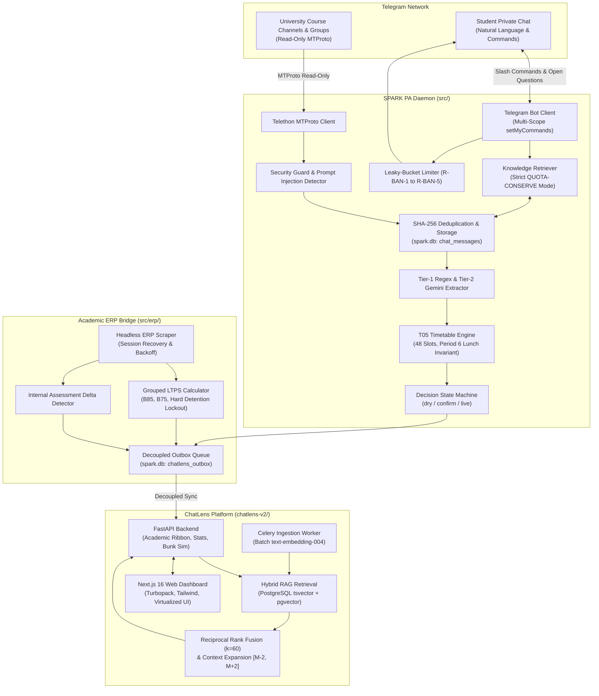

# ChatLens & SPARK PA — 2026–2027 Even Semester (T05) Architecture Specification

Version: 2.5.0  
Status: Authoritative Production  
Scope: SPARK PA Daemon (`src/`), ChatLens Web Platform (`chatlens-v2/`), and SQLite Integration Bridge (`spark.db`)

---

## 1. Executive Summary & Term Overview

The 2026–2027 Even Semester (Trimester-5 / T05) architecture represents a full-duplex, decoupled academic intelligence system serving second-year engineering undergraduates under the Project-Based Learning (PBL) model.

The system bridges raw university Telegram announcements and ERP portal crawls into structured Google Calendar/Tasks mutations, an interactive multi-scope Telegram PA bot, and a full-stack Next.js/FastAPI web platform.



---

## 2. Timetable T05 Engineering Specifications

The T05 timetable is codified in `data/timetable_T05.toml` and enforced via `src/timetable/__init__.py`.

### 2.1 Term Parameters & Boundaries
- **Term Identifier**: `T05` (Trimester-5, Academic Year 2026–2027).
- **Duration**: `04-Nov-2026` to `07-Feb-2027`.
- **Last Instruction Day**: `28-Jan-2027` (authoritative institutional cutoff for attendance).
- **Detention List Publication**: `29-Jan-2027`.
- **Total Weekly Contact Hours**: 48 periods across Monday through Saturday.

### 2.2 Course Portfolio & LTPS Composition
| Course Code | Name / Acronym | Credits | LTPS Structure | Faculty In-Charge | Room |
| :--- | :--- | :---: | :---: | :--- | :--- |
| `24CS2105A` | **GENAI** (Generative AI) | 4.0 | 3-0-2-0 | Dr. V. Rajesh | M-102 / Lab-4 |
| `24CS2104A` | **CNNP** (Computer Networks) | 4.0 | 3-0-2-0 | Dr. K. Swaminathan | C-304 / Lab-2 |
| `24CS2103A` | **DLAC** (Deep Learning & Comp.) | 4.0 | 3-1-0-2 | Prof. M. Sridhar | R-201 / Lab-7 |
| `24CS2102A` | **CIS** (Cloud Infrastructure) | 3.0 | 2-0-2-0 | Dr. P. Anitha | M-105 / Cloud Lab |
| `24CS2101A` | **GLBC** (Global Business & Ethics) | 2.0 | 2-0-0-0 | Dr. N. Lakshmi | B-402 |
| `24UC0010A` | **SDG** (Sustainable Dev. Goals) | 1.5 | 1-0-0-2 | Dr. B. Ramesh | Seminar Hall-1 |
| `24PE0001A` | **KABADDI** (Physical Education) | 0.5 | 0-0-2-0 | Coach K. Suresh | Sports Complex |

### 2.3 Extended Period Schedule & Period 6 Invariant
SPARK maps 11 discrete daily time periods:
- **P1**: `08:10 – 09:00`
- **P2**: `09:05 – 09:55`
- **P3**: `10:00 – 10:50`
- **P4**: `10:55 – 11:45`
- **P5**: `11:50 – 12:40`
- **P6**: `12:45 – 13:45` ➔ **STRICT CAMPUS LUNCH BREAK INVARIANT**
- **P7**: `13:50 – 14:40`
- **P8**: `14:45 – 15:35`
- **P9**: `15:40 – 16:30`
- **P10**: `16:35 – 17:15`
- **P11**: `17:20 – 18:00`

> [!IMPORTANT]
> **Period 6 Non-Assignable Invariant**: Period 6 (`12:45–13:45`) is strictly reserved for the university lunch interval. No timetable slots, makeup lectures, or room overrides can ever be assigned to Period 6. The timetable parser rejects any announcement claiming a Period 6 classwork slot.

---

## 3. Hierarchical LTPS Attendance Engine

Attendance in university PBL curricula is multi-modal. A single course code encompasses distinct instructional delivery types:
- **Lecture (L)**: Theory instruction in lecture halls.
- **Tutorial (T)**: Problem-solving and recitation in classrooms.
- **Practical (P)**: Hands-on laboratory experiments and simulation.
- **Skilling (S)**: Industrial application and project mentorship.

### 3.1 Mathematical Formulations
For each course $C$ with components $i \in \{L, T, P, S\}$:
1. **Component Percentage**:
   $$P_i = \frac{A_i}{C_i} \times 100$$
2. **Composite Attendance Percentage**:
   $$P_{\text{composite}} = \frac{\sum_i A_i}{\sum_i C_i} \times 100$$
3. **Safe Bunk Allowance ($B_T$)** for target threshold $T \in \{85\%, 75\%\}$:
   $$B_T = \left\lfloor \frac{\sum_i A_i - \frac{T}{100} \sum_i C_i}{\frac{T}{100}} \right\rfloor$$
4. **Classes Needed to Recover ($m_T$)** when $P_{\text{composite}} < T$:
   $$m_T = \left\lceil \frac{\frac{T}{100} \sum_i C_i - \sum_i A_i}{1 - \frac{T}{100}} \right\rceil$$
5. **Hard Detention Lockout Flag**:
   Let $R_C$ be the maximum remaining classes for course $C$ between the current date and `last_instruction_day` (2027-01-28).
   $$\text{Hard Detention} = \text{True} \iff m_{75} > R_C$$

---

## 4. Decoupled SQLite Outbox Event Contracts

The SPARK PA daemon and ChatLens web platform communicate asynchronously via the `chatlens_outbox` table in `spark.db`. This eliminates direct inter-process coupling and network dependencies.

### Schema: `chatlens_outbox`
```sql
CREATE TABLE IF NOT EXISTS chatlens_outbox (
    event_id TEXT PRIMARY KEY,
    event_type TEXT NOT NULL,
    payload TEXT NOT NULL,
    created_at REAL NOT NULL,
    processed_at REAL
);
CREATE INDEX IF NOT EXISTS idx_outbox_unprocessed 
ON chatlens_outbox(created_at) WHERE processed_at IS NULL;
```

### Event Contract Payloads

#### 1. `erp.attendance_update`
Emitted by `src.erp.sync` when attendance changes are detected:
```json
{
  "timestamp": "2026-11-14T20:15:00.000000+05:30",
  "term": "T05",
  "academic_year": "2026-2027",
  "semester_id": "SEM2",
  "deltas_count": 1,
  "deltas": [
    {
      "course_code": "24CS2105A",
      "course_name": "GENAI",
      "component": "Practical",
      "conducted_hours": 18,
      "attended_hours": 16,
      "percentage": 88.89,
      "safe_bunk_85": 0,
      "safe_bunk_75": 2
    }
  ]
}
```

#### 2. `erp.marks_update`
Emitted when new internal assessment grades or scores are published:
```json
{
  "timestamp": "2026-11-14T20:15:00.000000+05:30",
  "term": "T05",
  "course_code": "24CS2104A",
  "course_name": "CNNP",
  "deltas_count": 1,
  "deltas": [
    {
      "assessment_name": "Sem-In Exam 1",
      "max_marks": 25.0,
      "scored_marks": 23.5,
      "status": "PUBLISHED"
    }
  ]
}
```

#### 3. `academic.room_override`
Emitted when an authorized Telegram notice changes a lecture room:
```json
{
  "timestamp": "2026-11-14T08:15:00.000000+05:30",
  "target_date": "2026-11-14",
  "course_code": "24CS2103A",
  "course_name": "DLAC",
  "period": 3,
  "original_room": "R-201",
  "override_room": "M-102",
  "source": "[Chat: ECE_Dept, 14 Nov 08:10]"
}
```

---

## 5. Hybrid RAG Semantic Retrieval Engine

ChatLens v2 implements a hybrid dense-sparse search architecture combining lexical precision with vector semantics.

### 5.1 Reciprocal Rank Fusion ($RRF$)
Candidate messages are retrieved concurrently from PostgreSQL:
1. **Dense Retrieval**: `pgvector` Cosine Distance over 768-dimensional `text-embedding-004` embeddings.
2. **Sparse Retrieval**: PostgreSQL `tsvector` / `plainto_tsquery` English full-text search with `ts_rank_cd`.

Candidates are merged using the RRF algorithm ($k=60$):
$$RRF(m) = \sum_{S \in \{\text{dense}, \text{sparse}\}} \frac{1}{60 + \text{rank}_S(m)}$$

### 5.2 Context Window Expansion ($[M - 2, M + 2]$)
For the top $K$ fused message candidates, the retrieval engine fetches surrounding messages:
$$\text{Context}(m_i) = \{m_{i-2}, m_{i-1}, m_i, m_{i+1}, m_{i+2}\}$$
Overlapping boundaries are merged and messages are sorted chronologically, preserving conversation flow and eliminating hallucination risk.

---

## 6. Supervisor Stop Protocol & Process Isolation

SPARK PA daemon execution on Windows and Linux enforces deterministic lifecycle control:

1. **Win32 CIM Process Identification**: `Get-CimInstance Win32_Process` filters processes by exact command line (`python.exe -m src.main`), avoiding fragile single-PID or console-window assumptions.
2. **Graceful Stop File Watcher**: `scripts/run_daemon.ps1 -Stop` touches `logs/spark_daemon.stop`. The daemon's async loop polls this file and initiates clean network disconnection, state commits, and rate limiter flushing.
3. **8-Second Drain Window**: The supervisor waits up to 8.0s for clean exit. If any PID remains alive after the deadline, it escalates to `Stop-Process -Force`.
4. **Startup Debounce**: Startup notifications enforce a mandatory 900-second (15-minute) cooldown stored in SQLite `meta` (`daemon_startup_debounce`), preventing alert storms across restarts.
5. **Multi-Scope Telegram Bot Commands**: `DEFAULT_BOT_COMMANDS` are explicitly pushed to Telegram across three scopes:
   - `BotCommandScopeDefault`
   - `BotCommandScopeAllPrivateChats`
   - `BotCommandScopeChat` (direct owner ID)
