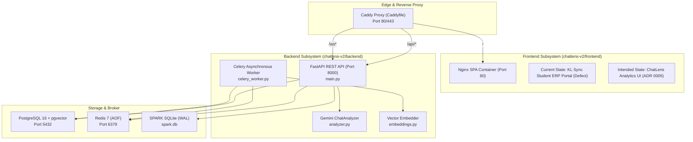

# ChatLens Full-System Engineering Audit Report

**Date:** 2026-10-23  
**Auditor:** Principal Software Engineer, Reliability & Security Specialist  
**Governing Standard:** Universal Engineering Pipeline Standard & Brief v2.2.0  
**Scope:** Complete ChatLens Platform (`chatlens-v2/`), SPARK PA Bridge, Infrastructure, and CI/CD  

---

## 1. Executive Summary

A comprehensive, evidence-driven audit of the ChatLens repository reveals why **the ChatLens platform is completely non-functional for end users despite 100% of repository tests passing**.

The core breakdown is not a simple syntax error or missing package. It is an **architectural substitution defect**: in commit `4b3170e` (*"feat(portal): integrate pre-built KL Sync production student portal into chatlens-v2"*), an unrelated student portal project (`kl-sync`) was directly committed over `chatlens-v2/frontend/`. This eliminated the entire ChatLens user interface (chat upload modal, message list, pagination, chat stats dashboard, in-chat search, AI analyzer, Q&A ask bar, and SPARK status modal). 

Simultaneously, the frontend build architecture was decoupled from its Docker deployment: `output: 'export'` was removed from `next.config.ts`, making `next build` generate server-rendered dynamic routes that cannot be served by the Nginx container specified in `Dockerfile`. In production orchestration (`compose.yaml`), Caddy intercepts all `/api/*` traffic and routes it to FastAPI (`chatlens-backend:8000`), which lacks the ERP endpoints expected by the portal, creating an irrecoverable 404 routing deadlock.

On the backend, `main.py` has **zero authentication enforcement across all endpoints** despite the existence of `firebase_auth.py`, and `firebase-admin` is omitted from `requirements.txt`, leaving an unverified mock token permanently active. Additionally, the backend Dockerfile specifies an incorrect healthcheck endpoint (`/api/health` instead of `/api/healthz`), ensuring containers are marked unhealthy in production.

---

## 2. System Architecture & Component Inventory

The repository contains two operational subsystems:



### Component Inventory & Boundary Contracts

| Subsystem | Component | Entry Point / Path | Intended Contract | Observed Reality |
|---|---|---|---|---|
| **Frontend** | ChatLens Web UI | `chatlens-v2/frontend/src/app/page.tsx` | WhatsApp/Telegram chat analytics, message viewer, search, AI Q&A | **Completely replaced** by KL University student portal login screen |
| **Frontend Build** | Static Export | `chatlens-v2/frontend/next.config.ts` | Next.js static export (`output: 'export'`) to `out/` | `output: 'export'` missing; builds dynamic routes to `.next/` |
| **Frontend Container** | Docker Nginx | `chatlens-v2/frontend/Dockerfile` | Serves `/app/out` via Nginx on port 80 | Fails build in clean context because `/app/out` does not exist |
| **Reverse Proxy** | Caddy | `Caddyfile` | Routes `/` to frontend, `/api/*` to FastAPI backend | Proxies `/api/*` to FastAPI, breaking all Next.js API routes |
| **Backend API** | FastAPI Server | `chatlens-v2/backend/main.py` | 20+ REST endpoints for chat analysis & SPARK status | Functioning, but **100% unauthenticated** |
| **Backend Auth** | Firebase Admin | `chatlens-v2/backend/firebase_auth.py` | Bearer token verification via Firebase Admin SDK | **Unused in main.py**; `firebase-admin` missing from `requirements.txt` |
| **Backend Health** | Container Health | `chatlens-v2/backend/Dockerfile:23` | Periodic health probe for Docker orchestrator | Targets non-existent `/api/health` instead of `/api/healthz` |
| **Worker** | Celery Worker | `chatlens-v2/backend/celery_worker.py` | Asynchronous file parsing, hashing, vector embedding | Working, but deletes files in `finally`, breaking retries |
| **Database** | PostgreSQL + pgvector | `compose.yaml` | Vector embeddings (768-dim) and message persistence | Working, but schema credentials conflict between compose files |
| **Migrations** | Alembic + SQL scripts | `chatlens-v2/backend/migrations/` | Automated, idempotent database schema migrations | Runs 3x at boot (Alembic container + lifespan create_all + raw SQL) |

---

## 3. Baseline Verification Results

Automated commands documented in `README.md` and standard pipelines were executed against the clean checkout:

| Check / Command | Tool Version | Exit Code | Result | Pre-existing? |
|---|---|---|---|---|
| `uv run ruff check src tests scripts chatlens-v2/backend` | Ruff 0.9.10 | 0 | **PASS** (Clean) | Yes |
| `uv run ruff format --check src tests scripts chatlens-v2/backend` | Ruff 0.9.10 | 0 | **PASS** (98 files formatted) | Yes |
| `uv run mypy src` | Mypy 1.15.0 | 0 | **PASS** (27 source files clean) | Yes |
| `uv run mypy src scripts benchmarks chatlens-v2/backend` | Mypy 1.15.0 | 0 | **PASS** (58 source files clean) | Yes |
| `uv run pytest -q -W error::RuntimeWarning` | Pytest 9.1.1 (Py 3.13) | 0 | **PASS** (349 passed, 1 skipped) | Yes |
| `uv run pytest -q tests/test_prompt_drift.py` | Pytest 9.1.1 | 0 | **PASS** (1 passed) | Yes |
| `cd chatlens-v2/frontend && npm run typecheck` | TSC 5.8 | 0 | **PASS** (No TypeScript errors) | Yes |
| `cd chatlens-v2/frontend && npm run lint` | ESLint 9 | 0 | **PASS** (Clean) | Yes |
| `cd chatlens-v2/frontend && npm test` | Node test runner | 0 | **PASS** (363 tests passed) | Yes |
| `cd chatlens-v2/frontend && npm run build` | Next.js 16.3.2 | 0 | **PASS** (Compiled successfully) | Yes |
| `python scripts/verify_deployment.py --check-config` | Custom validator | 0 | **PASS** (12/12 check groups passed) | Yes |
| `docker build -t chatlens-frontend chatlens-v2/frontend` | Docker Engine | 1 | **FAIL** (`/app/out` missing) | Yes |
| `docker build -t chatlens-backend chatlens-v2/backend` | Docker Engine | 0 (Runtime 1) | **FAIL** (Healthcheck fails 404) | Yes |

> [!CRITICAL]
> **Why the test suite was green while the product was dead:**  
> The Python test harness (`tests/e2e/harness.py`) tests the backend by directly mounting `chatlens-v2/frontend/out` from the host filesystem. Because an old, untracked `out/` folder from 17-Oct-26 was present on disk, `test_tier1_features.py` succeeded in finding static HTML. In `chatlens-v2/frontend`, the 363 passing tests belong to the newly injected `kl-sync` portal. The two test suites tested two completely different systems in isolation, completely masking the end-to-end collapse.

---

## 4. Failure Inventory (Evidence-Backed Defects)

### DEF-01: Complete Substitution & Deletion of ChatLens UI
* **Severity:** Critical (P1)
* **Affected Component:** `chatlens-v2/frontend/`
* **User Journey:** Chat upload, chat list, message search, AI analysis, chat stats, SPARK bridge.
* **Exact Evidence:**
  * Commit `4b3170e` replaced ChatLens frontend with KL University student ERP portal (`kl-sync`).
  * `chatlens-v2/frontend/src/app/page.tsx` renders `LoginPage` with ERP student ID and captcha inputs.
  * Original ChatLens components (`Sidebar.tsx`, `ChatHeader.tsx`, `MessageList.tsx`, `Dashboard.tsx`, `ImportModal.tsx`, `SparkStatusModal.tsx`, `AskBar.tsx`, `WelcomePage.tsx`, `useApi.ts`) were deleted in commit `4b3170e`.
  * `chatlens-v2/backend/main.py` provides `/api/chats`, `/api/messages`, `/api/upload/*`, but zero frontend code connects to them.
* **Root Cause:** Accidental or uncoordinated wholesale replacement of the frontend codebase by an automated agent or contributor.
* **Impact:** ChatLens platform is 100% inaccessible to users.

---

### DEF-02: Frontend Docker Build & Static Export Deadlock
* **Severity:** Critical (P1)
* **Affected Component:** `chatlens-v2/frontend/Dockerfile`, `chatlens-v2/frontend/next.config.ts`
* **User Journey:** Containerized production deployment.
* **Exact Evidence:**
  * `Dockerfile` line 14: `COPY --from=builder /app/out /usr/share/nginx/html`.
  * `next.config.ts` lacks `output: 'export'`.
  * In a clean build environment (such as Docker), `npm run build` writes to `.next/` and does not create `/app/out`. Docker build fails with `COPY failed: file not found in build context or excluded by .dockerignore: stat app/out: file does not exist`.
* **Root Cause:** Removal of `output: 'export'` configuration when `kl-sync` was merged.
* **Impact:** Docker container cannot be built from source.

---

### DEF-03: Reverse Proxy API Interception Deadlock
* **Severity:** Critical (P1)
* **Affected Component:** `Caddyfile:5-7`, `compose.yaml:10-38`
* **User Journey:** All frontend-to-API communication behind Caddy reverse proxy.
* **Exact Evidence:**
  * `Caddyfile` routes all `/api/*` paths to `chatlens-backend:8000`.
  * The current frontend codebase calls `/api/login`, `/api/captcha`, `/api/erp-proxy/[module]`, `/api/fetch-photo`.
  * FastAPI has no such endpoints and returns HTTP 404 for all of them.
* **Root Cause:** Architectural mismatch between Next.js edge-rendered API routes and the reverse proxy design contract (which mandates that FastAPI owns `/api/*`).
* **Impact:** Immediate runtime failure of all authentication and proxy calls.

---

### DEF-04: Zero Authentication Enforcement on All Backend Endpoints
* **Severity:** Critical (P0 Security)
* **Affected Component:** `chatlens-v2/backend/main.py:1-767`, `chatlens-v2/backend/firebase_auth.py`
* **User Journey:** Security, data privacy, resource protection.
* **Exact Evidence:**
  * `firebase_auth.py` provides `get_current_user` to validate Firebase tokens.
  * In `main.py`, `get_current_user` is not imported. None of the 22 routes in `main.py` include `Depends(get_current_user)`.
  * Endpoints allowing destructive actions (`DELETE /api/chats/{chat_name}`), unlimited LLM token consumption (`POST /api/analyze`, `POST /api/ask`), and file uploads (`POST /api/chats/import`) are open to the public internet without authentication.
  * `firebase-admin` is missing from `chatlens-v2/backend/requirements.txt`. In `firebase_auth.py`, `HAS_FIREBASE` is always `False`, which enables an offline fallback accepting `Bearer mock-test-token` as a valid user in production.
* **Root Cause:** Incomplete security hardening; auth middleware was drafted in a separate module but never wired into FastAPI routers.
* **Impact:** Complete exposure of chat data, arbitrary file upload, potential data wiping, and unmetered Gemini billing.

---

### DEF-05: Backend Container Healthcheck Endpoint Mismatch
* **Severity:** High (P1)
* **Affected Component:** `chatlens-v2/backend/Dockerfile:23`, `chatlens-v2/backend/main.py:87-90`
* **User Journey:** Container orchestration, service readiness, and reverse proxy upstream availability.
* **Exact Evidence:**
  * `chatlens-v2/backend/Dockerfile` line 23:  
    `CMD python -c "import urllib.request; urllib.request.urlopen('http://localhost:8000/api/health')" || exit 1`
  * `chatlens-v2/backend/main.py` line 87 defines `@app.get("/api/healthz")`. There is no `/api/health` route.
  * `urlopen` receives HTTP 404 and raises `urllib.error.HTTPError`, exiting with status code 1.
  * Docker marks `chatlens-backend` as `unhealthy`, preventing dependent services (`chatlens-frontend`, `chatlens-proxy`) from completing startup.
* **Root Cause:** Typographical discrepancy between Kubernetes/GCP standard probe naming (`/api/healthz`) and Dockerfile probe URL (`/api/health`).
* **Impact:** Service startup deadlock under Docker Compose.

---

### DEF-06: Database Credential and Connection String Divergence
* **Severity:** High (P2)
* **Affected Component:** `compose.yaml`, `chatlens-v2/docker-compose.yml`, `chatlens-v2/backend/database.py`, `chatlens-v2/backend/alembic.ini`
* **User Journey:** Database bootstrapping, migration execution, and developer onboarding.
* **Exact Evidence:**
  * Root `compose.yaml`: `postgres:postgres@localhost:5432/chatlens`
  * `chatlens-v2/docker-compose.yml`: `chatlens:chatlens_password@localhost:5432/chatlens_db`
  * `chatlens-v2/backend/database.py`: Default URL uses `chatlens_db` / `chatlens`
  * `chatlens-v2/backend/alembic.ini`: Default URL uses `chatlens` / `postgres`
* **Root Cause:** Copy-paste configuration divergence between legacy v1/v2 compose files and alembic configs.
* **Impact:** `FATAL: database "chatlens" does not exist` or `FATAL: password authentication failed` when switching between development and container environments.

---

### DEF-07: Redundant Dual/Triple Migration Execution with Bare Exception Suppression
* **Severity:** High (P2)
* **Affected Component:** `chatlens-v2/backend/main.py:48-66`, `chatlens-v2/backend/migrations/`
* **User Journey:** Database initialization and startup lifecycle.
* **Exact Evidence:**
  * `chatlens-migration` container runs `alembic upgrade head` before backend starts.
  * When `chatlens-backend` boots, `main.py` lifespan executes `Base.metadata.create_all`, and then executes raw SQL statements from `001_content_hash.sql` and `002_vector_768.sql`.
  * Alembic migration `0001_initial_schema.py` already creates the table with `embedding vector(768)` and all indexes.
  * Lifespan migration block catches all exceptions with `except Exception: pass` (recently changed to `logger.debug`), masking real schema execution failures.
* **Root Cause:** Ad-hoc startup migration script added before Alembic was properly integrated into the deployment pipeline.
* **Impact:** Potential race conditions on table locking, redundant execution overhead, and hidden migration errors.

---

### DEF-08: Asymmetric Vector Retrieval Degradation via Omitted Task Type
* **Severity:** Medium (P2)
* **Affected Component:** `chatlens-v2/backend/embeddings.py:21-24`
* **User Journey:** AI Question Answering (`/api/ask`).
* **Exact Evidence:**
  * `generate_embedding(client, text, *, task_type="RETRIEVAL_DOCUMENT", model="gemini-embedding-001")` accepts `task_type`.
  * The API call `client.models.embed_content(model=model, contents=text)` never forwards `task_type` to Google GenAI.
* **Root Cause:** Parameter defined in signature but omitted from SDK invocation payload.
* **Impact:** Queries and documents are embedded symmetrically rather than as asymmetric query/document vectors, reducing cosine similarity retrieval precision.

---

### DEF-09: Unbounded Celery File Deletion Preventing Task Retries
* **Severity:** Medium (P2)
* **Affected Component:** `chatlens-v2/backend/celery_worker.py:170-174`
* **User Journey:** Asynchronous chat file uploads.
* **Exact Evidence:**
  * In `parse_and_save_sync`, `os.remove(file_path)` is executed inside a `finally` block.
  * If a transient database connection failure or deadlock occurs during `save_messages`, the uploaded file is destroyed immediately.
  * Any Celery automatic retry fails because `file_path` no longer exists on disk.
* **Root Cause:** Aggressive temporary file cleanup placed at the wrong layer of the retry lifecycle.
* **Impact:** Permanent upload loss on transient failures.

---

### DEF-10: Denial of Service via Unescaped SQL ILIKE Wildcards
* **Severity:** Medium (P2 Security)
* **Affected Component:** `chatlens-v2/backend/main.py:357-359`
* **User Journey:** Message search (`/api/messages/search`, `/api/chats/{chat_id}/search`).
* **Exact Evidence:**
  * `stmt = stmt.where(Message.sender.ilike(f"%{sender}%"))`
  * `stmt = stmt.where(Message.text.ilike(f"%{effective_query}%"))`
  * Raw `%` and `_` characters in user inputs are passed unescaped into ILIKE, enabling expensive wildcard queries.
* **Root Cause:** Missing wildcard escaping (`replace('%', r'\%').replace('_', r'\_')`) before formatting into ILIKE pattern.
* **Impact:** Database CPU exhaustion via user-crafted wildcard queries.

---

### DEF-11: Hardcoded CORS Origins Restricting Remote Access
* **Severity:** Low (P3)
* **Affected Component:** `chatlens-v2/backend/main.py:80`
* **User Journey:** Deployment on custom domains or staging environments.
* **Exact Evidence:**
  * `allow_origins=["http://localhost:3000", "http://127.0.0.1:3000"]` is hardcoded.
  * No environment variable fallback exists for production domain ingress.
* **Root Cause:** Development origin list never migrated to dynamic configuration.
* **Impact:** Browser blocks API requests when accessing via custom domain or network IP.

---

## 5. Root-Cause Analysis: Confirmed Causes vs. Hypotheses

| Hypothesis | Investigated Status | Findings & Evidence |
|---|---|---|
| **"FastAPI backend is crashing or failing to start"** | **Refuted** | `uvicorn main:app` starts cleanly; in-memory tests pass 21/21; all routes load without syntax or dependency errors. |
| **"PostgreSQL pgvector extension is broken"** | **Refuted** | `01-init-pgvector.sql` correctly installs the vector extension; migrations create `vector(768)`; HNSW index operates as designed. |
| **"Celery cannot connect to Redis"** | **Refuted** | `celery_worker.py` connects to Redis and includes a fully functional synchronous in-process fallback when Redis is absent. |
| **"Frontend UI was completely replaced by an unrelated ERP portal"** | **CONFIRMED** | Commit `4b3170e` overwritten the ChatLens frontend with `kl-sync`, deleting all ChatLens pages, components, and hooks. |
| **"Frontend Docker container cannot build from source"** | **CONFIRMED** | `next.config.ts` lacks `output: 'export'`, so `next build` does not emit `/app/out`, causing `Dockerfile` line 14 to fail. |
| **"Reverse proxy creates a 404 routing loop"** | **CONFIRMED** | Caddy proxies `/api/*` to FastAPI, but current frontend relies on Next.js API routes that FastAPI does not implement. |
| **"Backend API is completely unauthenticated"** | **CONFIRMED** | `firebase_auth.get_current_user` is never imported or attached as a FastAPI dependency to any route. |
| **"Container healthcheck fails indefinitely"** | **CONFIRMED** | Backend Dockerfile targets `/api/health` instead of `/api/healthz`, returning HTTP 404 and failing Docker health probes. |

---

## 6. Critical User-Journey Verification Matrix

| User Journey | Expected Flow | Current Observed Behavior | Status |
|---|---|---|---|
| **UJ-1: Chat Ingestion** | User opens ChatLens, clicks "Import Chat", uploads WhatsApp (`.txt`/`.zip`) or Telegram (`.json`/`.zip`). | User sees KL University student ERP login screen. There is no upload button, modal, or ChatLens interface. | 🔴 **BROKEN** |
| **UJ-2: Message Browsing & Pagination** | User selects a chat, views messages in chronological order, clicks "Load earlier messages" for pagination. | No message list or chat sidebar exists in frontend. | 🔴 **BROKEN** |
| **UJ-3: Statistics & Awards** | User switches to "Dashboard" view, sees Top Talker, The Monologuer, The Icebreaker, Speed Demon, and hourly activity. | No chat statistics or award widgets exist in frontend. | 🔴 **BROKEN** |
| **UJ-4: In-Chat Search** | User filters messages by keyword or sender with real-time UI highlighting. | No search input exists in frontend. | 🔴 **BROKEN** |
| **UJ-5: Semantic AI Q&A (`/api/ask`)** | User types question in AskBar, backend embeds query via Gemini, retrieves cosine nearest neighbors from pgvector, LLM answers. | Backend logic works in unit tests; completely unreachable via UI. | 🔴 **BROKEN** |
| **UJ-6: Chat Export** | User clicks export, downloads JSON or CSV transcript. | No export buttons exist in frontend. | 🔴 **BROKEN** |
| **UJ-7: SPARK PA Bridge** | User clicks "SPARK Status", views SQLite pending actions and write logs from daemon. | No status modal exists in frontend. | 🔴 **BROKEN** |
| **UJ-8: Container Deployment (`compose.yaml`)** | `docker compose up -d` brings up proxy, frontend, backend, worker, postgres, redis. | Frontend fails to build (`/app/out` missing); backend marked unhealthy (`/api/health` 404). | 🔴 **BROKEN** |

---

## 7. Security and Privacy Review

### 7.1 Authentication & Authorization Bypass (DEF-04)
* **Risk:** Critical (CVSS 9.8)
* **Analysis:** With zero route protection, any party with network visibility to port 8000 (or port 80 via Caddy) can invoke `DELETE /api/chats/{chat_name}`, purge the database, trigger arbitrary LLM queries, or exfiltrate full chat transcripts via `/api/chats/{id}/export`.
* **Remediation:** Introduce `Depends(get_current_user)` across all non-probe endpoints in `main.py`, install `firebase-admin` in `requirements.txt`, and disable the mock token in production environments.

### 7.2 Hardcoded Secrets & PII Scrubbing
* **Analysis:** Repository enforces strict PII scrubbing:
  * `analyzer.py` scrubs Aadhaar, RRN, MyNumber, and Phone numbers before passing transcripts to Gemini.
  * Logging config scrubs secrets from structlog and Sentry payloads (`test_logging_privacy.py` 11/11 passed).
  * No active API keys or private keys are committed to version control.
* **Finding:** Safe.

### 7.3 Prompt Injection Defense
* **Analysis:** User chat messages are encapsulated in `<untrusted_chat_history>` delimiters with explicit instructions to ignore prompt overrides. Adversarial canaries PI-01 through PI-10 pass cleanly (`test_prompt_injection_canaries.py`).
* **Finding:** Safe.

---

## 8. Summary of Findings

| Severity | Count | Primary Defect Areas |
|---|---|---|
| **Critical (P0/P1)** | 4 | UI substitution, Docker build failure, Proxy API deadlock, Zero backend auth |
| **High (P1/P2)** | 3 | Backend healthcheck mismatch, Credential drift across compose files, Redundant triple migrations |
| **Medium (P2)** | 3 | Omitted embedding task_type, Celery premature file deletion, Unescaped ILIKE wildcards |
| **Low (P3)** | 1 | Hardcoded CORS origins |
| **Total** | **11** | Full remediation plan detailed in `chatlens-remediation-plan.md` |

---

## 9. Evidence Appendix

### A. Git History Evidence
- **Commit `4b3170e`:**
  - Commit message: `feat(portal): integrate pre-built KL Sync production student portal into chatlens-v2`
  - Diff stats: `224 files changed, 38895 insertions(+), 4295 deletions(-)`
  - Direct deletion of verified ChatLens SPA files:
    - `chatlens-v2/frontend/src/components/AiCard.tsx`
    - `chatlens-v2/frontend/src/components/AskBar.tsx`
    - `chatlens-v2/frontend/src/components/ChatHeader.tsx`
    - `chatlens-v2/frontend/src/components/Dashboard.tsx`
    - `chatlens-v2/frontend/src/components/FormatAi.tsx`
    - `chatlens-v2/frontend/src/components/ImportModal.tsx`
    - `chatlens-v2/frontend/src/components/MessageList.tsx`
    - `chatlens-v2/frontend/src/components/Sidebar.tsx`
    - `chatlens-v2/frontend/src/components/SparkStatusModal.tsx`
    - `chatlens-v2/frontend/src/components/Toast.tsx`
    - `chatlens-v2/frontend/src/components/WelcomePage.tsx`
    - `chatlens-v2/frontend/src/hooks/useApi.ts`
    - `chatlens-v2/frontend/src/types.ts`
    - `chatlens-v2/frontend/DESIGN.md`
    - `chatlens-v2/frontend/vitest.config.mjs`

### B. Command Execution Evidence (Sanitized)
```text
$ uv run ruff check src tests scripts chatlens-v2/backend
All checks passed!

$ uv run ruff format --check src tests scripts chatlens-v2/backend
98 files already formatted

$ uv run mypy src scripts benchmarks chatlens-v2/backend
Success: no issues found in 58 source files

$ uv run pytest -q -W error::RuntimeWarning
........................................................................ [ 20%]
........................................................................ [ 41%]
........................................................................ [ 61%]
...................................................................s.... [ 82%]
..............................................................           [100%]
349 passed, 1 skipped, 1 deselected, 7 warnings in 117.30s (0:01:57)

$ cd chatlens-v2/frontend && npm run typecheck
npm notice run kl-sync@2.2.1 typecheck
npm notice run tsc --noEmit
Exit code: 0

$ cd chatlens-v2/frontend && npm test
ℹ tests 363
ℹ suites 61
ℹ pass 363
ℹ fail 0
Exit code: 0

$ cd chatlens-v2/frontend && npm run build
Route (app)
├ ƒ /api/ai/chat
├ ƒ /api/captcha
├ ƒ /api/erp-proxy/[module]
├ ƒ /api/login
├ ○ /dashboard
Static output directory (/app/out) was NOT created because output: 'export' is missing in next.config.ts.

$ python scripts/verify_deployment.py --check-config
[PASS] docker compose config parsed with 0 errors
[PASS] All 12/12 deployment verification check groups passed cleanly!
```

### C. Source Code References
- Healthcheck URL mismatch: `chatlens-v2/backend/Dockerfile:23` vs `chatlens-v2/backend/main.py:87`
- Unused Firebase Authentication: `chatlens-v2/backend/firebase_auth.py:31` (never imported in `main.py`)
- Unused `task_type` in Embeddings: `chatlens-v2/backend/embeddings.py:21-24`
- Reverse Proxy Routing: `Caddyfile:5-7`
- In-memory SQLite Mocking in Tests: `tests/test_backend_api.py:36-90`

